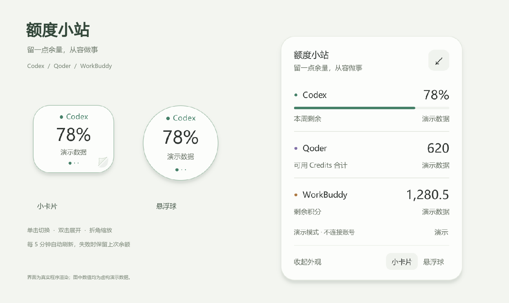
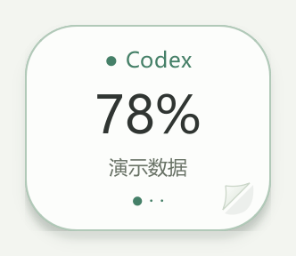
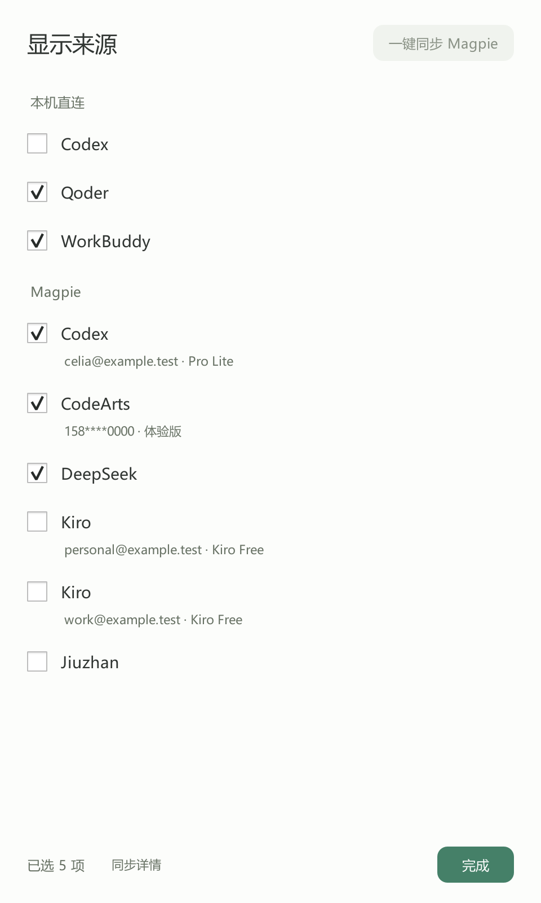

# 额度小站 · Quota Station

**留一点余量，从容做事。**

一个便签风格的 Windows / macOS 桌面小组件，把自己选中的 AI 额度放在手边。Windows 支持 **Codex、Qoder、WorkBuddy 本机直连**；macOS 支持 **Codex CLI**。两端都能读取 **Magpie 已接入的账号和 API 余额**。收起是一张小卡片或悬浮球，展开查看已选来源。



> 上图由真实程序渲染，全部使用虚构演示数值，不对应任何真实账号。各平台单位不同，分别展示，不跨平台相加。

**培训实践案例：** [在线阅读图文说明](docs/case-study.md) · [下载作业 PDF](output/pdf/额度小站-AI工作辅助实践案例.pdf)

## 从一个真实的小需求开始

在使用多种 AI 工具辅助生物信息学分析及日常工作时，频繁切换客户端查看额度会打断正在进行的操作。这个项目借助 Codex，把“在桌面上看一眼剩余额度”的想法做成一个实际可用的小工具。

需求和审美取舍由使用者提出，Codex 辅助实现、调试与测试。便签外观、单击轮换、双击展开和可拖动的书页折角，都来自实际使用中的迭代。Qoder 与 WorkBuddy 在这个案例中是被监测的平台。

## 可以做什么

| 操作 | 效果 |
| --- | --- |
| 点击小卡片左侧 / 右侧 | 向上一页 / 下一页翻动，在勾选的来源之间循环 |
| 单击悬浮球 | 切换到下一个已选来源 |
| 双击 | 展开已选额度，来源较多时可滚动 |
| 显示来源 | 勾选本机直连或 Magpie 的账号，立即生效并自动保存 |
| 拖动主体 | 调整桌面位置 |
| 拖动右下角书页折角 | 小卡片等比例缩放，范围 80%–200% |
| 便签右上角 / Esc | 收起并保留当前选择 |
| 右键 / F5 | 刷新、置顶、隐藏到托盘或退出 |

- 位置、大小、外形、置顶和显示来源自动保存；每次启动显示选中列表的第一项，首次使用默认 Codex、Qoder、WorkBuddy。
- 每 5 分钟刷新一次，可随时手动刷新。
- 更新失败时保留上次成功值并显示状态；未知额度不会伪装成 0。
- 悬停查看更新时间和明细，右键额度行可打开详情。
- 小卡片翻页时，纸面和内容沿弯曲表面产生透视变化，露出纸背并投下移动的阴影，约 0.52 秒完成：下一页从右下角翻向左上角，上一页从左上角翻向右下角。双击展开、拖动和折角缩放照常使用，左右方向键也可翻页。
- Codex 显示优先选择的周额度剩余百分比；Qoder 显示可用 Credits 合计；WorkBuddy 显示剩余积分。



## 选择显示来源

展开小站，点击左下角的 **显示来源**；也可以从卡片或托盘的右键菜单打开。

- **本机直连**：原有的 Codex、Qoder、WorkBuddy，可分别勾选。
- **Magpie**：自动列出它当前接入的额度来源，同一平台的不同账号独立选择。新增来源默认不勾选。
- 点击 **一键同步 Magpie**，自动检测正在运行的程序、PATH、Windows 安装记录和常用安装目录，读取它当前的网关端口，并同步已有账号及最新额度。检测到的程序路径会保存在小站设置中。
- **同步详情** 可查看和复制程序路径，并查看版本、连接方式和上次同步时间。同步只更新来源和额度，保留已经勾选的显示项。
- 勾选即保存，同时影响小卡片轮换和展开列表。全部取消时保留“选择显示来源”入口。
- 本机直连与 Magpie 中同名平台是不同来源，可任选；不会将两者的余额相加。
- 连接失败保留上次成功值，并标记“更新失败”；账号暂时从 Magpie 消失时仍保留已有选择。



直接打开选择页或离线演示：

```powershell
.\.venv\Scripts\pythonw.exe app.py --sources
.\.venv\Scripts\python.exe demo.py --sources
```

## 快速开始

**直接使用：** 到 [GitHub Releases](https://github.com/Seraph310/quota-station/releases/latest) 下载对应系统的程序，无需安装 Python。

| 系统 | 下载与启动 |
| --- | --- |
| Windows 10/11 x64 | 下载 Windows ZIP，完整解压后打开 `QuotaStation/QuotaStation.exe`；保留 `_internal` 文件夹 |
| macOS · Apple 芯片 | 下载 arm64 DMG，把 `.app` 拖入 Applications |
| macOS · Intel | 下载 x64 DMG，把 `.app` 拖入 Applications |

Mac 下载版在 macOS 15 上构建和验证，尚未适配 Qoder、WorkBuddy 的原生登录读取。当前包未做商业代码签名，Mac 包未经 Apple 公证；首次打开说明和设置位置见 [下载版说明](docs/DOWNLOAD.md)。换电脑后需在新电脑登录相应客户端，或配置本机 Magpie。

**从源码运行：** 需要 Python 3.11+。Windows 可使用以下安装脚本：

```powershell
git clone https://github.com/Seraph310/quota-station.git
cd quota-station
powershell -NoProfile -ExecutionPolicy Bypass -File .\install.ps1 -DesktopShortcut
```

安装脚本只在项目的 `.venv` 中安装 Python 依赖；`-DesktopShortcut` 创建桌面快捷方式。它不安装各平台客户端、不更改全局配置，也不自动启动应用。

**先体验界面，无需登录任何账号：**

```powershell
.\.venv\Scripts\python.exe demo.py --expanded
```

演示模式使用临时目录和虚构数值，不读取真实登录与余额缓存，不联网查询。界面会明确显示“演示数据”。

**连接自己的账号：**

准备好下表中的客户端登录后，双击桌面的「额度小站」，或运行：

```powershell
.\.venv\Scripts\pythonw.exe app.py
```

也可双击仓库里的 `额度小站.vbs`。移动项目文件夹后，重新运行 `setup_desktop.ps1` 生成指向新位置的桌面快捷方式。

## 额度来源与连接条件

| 平台 | 来源与条件 |
| --- | --- |
| Codex | 已安装并通过 ChatGPT 账号登录的 Codex CLI，使用 `account/rateLimits/read`；不创建模型任务。仅有桌面 App 不一定包含可调用的 CLI。 |
| 新版 Qoder App | 优先复用当前 Windows 用户的独立 App 登录，已适配 0.4.3。只读解密本机登录，在内存中向客户端使用的 `GET /sash/api/v2/me/usage` 查询；无需启动旧 IDE，也无需 Node.js。登录过期时打开新版 Qoder 更新登录。 |
| 旧 Qoder 环境 | 无新版 App 配置时，支持官方 SDK 的 `getUsageInfo()`，再回退到正在运行且已登录的国际版 Qoder IDE 本地 `credit/usage`。此路径需要 Node.js。 |
| WorkBuddy | 同一 Windows 用户已有 WorkBuddy 登录。优先读取已有加密缓存；必要时只读访问 WorkBuddy 服务进程内存获取登录令牌，再向其计费接口查询。新用户无需安装旧积分球。 |
| Magpie | “一键同步”自动检测安装位置，通过 `magpie status --json` 读取当前网关端口，再查询本机 `/v1/magpie/quotas`；网关未运行时使用检测到的 `magpie.exe quota --json`。无需再次填写 API Key；登录与账号管理仍在 Magpie 中完成。特殊安装可用 `QUOTA_MAGPIE_EXECUTABLE` 或 `QUOTA_MAGPIE_PORT` 指定。 |

Magpie 接入只查询额度，不修改路由、启用状态、自动重置、通知或 Credits 消费设置。窗口同时有百分比与用量总额时优先展示可用数量；货币保持原币种，负余额如实显示。描述性“Unknown”不会被当成 100% 可用。

Qoder 合计包括套餐、附加包、分配给当前用户的组织额度和可用专用包；过期、暂停和不可用包不计入。专用包的使用范围仍以 Qoder 为准。官方界面按包展示，本项目的合计是这些可用分项的汇总。新版 App 账号存在时，查询失败不会静默切到另一个 IDE/CLI 账号。

可选安装旧 Qoder SDK 依赖（需 Node.js 20+ 和 npm）：

```powershell
powershell -NoProfile -ExecutionPolicy Bypass -File .\install.ps1 -WithQoderSdk
```

如 Codex CLI 未在 PATH 中，可仅为本次 PowerShell 会话指定其**原生可执行文件**：

```powershell
$env:QUOTA_CODEX_EXECUTABLE = 'C:\path\to\codex.exe'
.\.venv\Scripts\pythonw.exe app.py
```

## 本地数据与兼容性

- 项目不设账号中转服务器，本机直连查询发往各平台自身的服务，Magpie 来源通过它的本机接口或 CLI 读取。登录凭证不写入明文日志。
- Qoder 登录文件只读，不修改或刷新原凭证。WorkBuddy 如需新增缓存，使用 Windows 数据保护 API（DPAPI）加密，保存在项目 `.cache` 中；不修改原缓存或进程，不请求调试提权。
- `state/` 存本地设置、显示来源、账号显示名称和余额快照；`.cache/`、虚拟环境、真实验证结果和本机截图均排除在 Git 之外。请勿把这些目录一起公开打包。
- 以上相对路径适用于源码运行。下载版保存到 Windows `%LOCALAPPDATA%\QuotaStation` 或 macOS `~/Library/Application Support/QuotaStation`，更新或移动程序会保留设置。安装包不包含真实账号、余额缓存和凭证。
- 本项目是个人实践作品。客户端兼容接口可能随版本变化；企业专属用量页、非标准服务域名和其他平台系统尚未全面适配。它不承诺跨电脑即装即用，数值以各平台自身页面为准。

## 开发与验证

```powershell
.\.venv\Scripts\python.exe -m unittest discover -s tests -p "test_*.py"
.\.venv\Scripts\python.exe tools\render_demo.py
.\.venv\Scripts\python.exe tools\render_sources.py
.\.venv\Scripts\python.exe tools\render_page_turn.py
```

自动化测试使用合成响应、模拟网络和离屏界面，不访问真实账号。`tools/render_demo.py` 生成可公开的演示图。开发用的 `verify_live.py`、`verify_qoder_app.py` 和 `render_check.py` 会读取当前用户的真实状态，输出已通过 `.gitignore` 排除，不用于公开展示。

构建下载版：在目标系统安装 `requirements-build.txt`，运行 `python tools/build_release.py`。该脚本会测试实际打包后的程序，再生成 Windows ZIP 或 macOS DMG。产物在 `dist/release/`，隔离的启动验证图和报告在 `build/smoke/`。推送与 `version.py` 一致的 `v*` 标签会触发三平台构建并创建草稿 Release，核对后发布；手动运行 `Build desktop apps` 时可选择只构建，或在检查通过后创建草稿 Release。

`tools/verify_magpie_sync.py` 可单独验证真实的同步按钮、自动检测、读取和设置保存；它使用隔离的临时小站状态，不改变正在运行的小站的显示选择。验证报告存放在已忽略的 `tests/magpie_sync_verification.json`。

| 文件 / 目录 | 用途 |
| --- | --- |
| `app.py` / `demo.py` | 实际界面 / 隔离的离线演示 |
| `providers/` | 本机平台与 Magpie 的额度适配器 |
| `source_picker.py` | 显示来源选择页 |
| `page_turn.py` | 小卡片的双向翻页动画 |
| `install.ps1` / `setup_desktop.ps1` | 安装依赖 / 创建快捷方式 |
| `tests/` | 额度解析、账号边界和界面交互测试 |
| `docs/` / `output/pdf/` | 图文案例、演示图和可提交的 PDF |

相关资料：[Codex App Server](https://learn.chatgpt.com/docs/app-server) · [Qoder SDK 额度查询](https://docs.qoder.com/cli/sdk/cost-usage) · [新版 Qoder](https://docs.qoder.com/qoder/overview)
