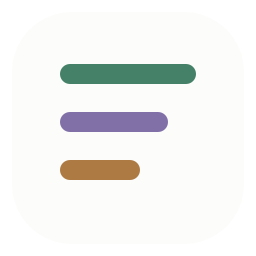
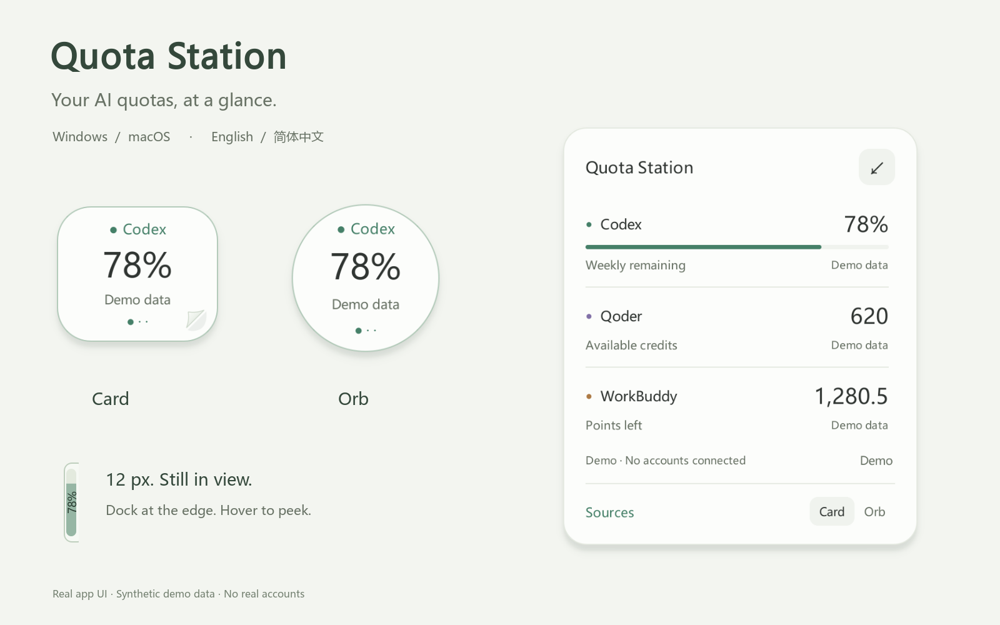
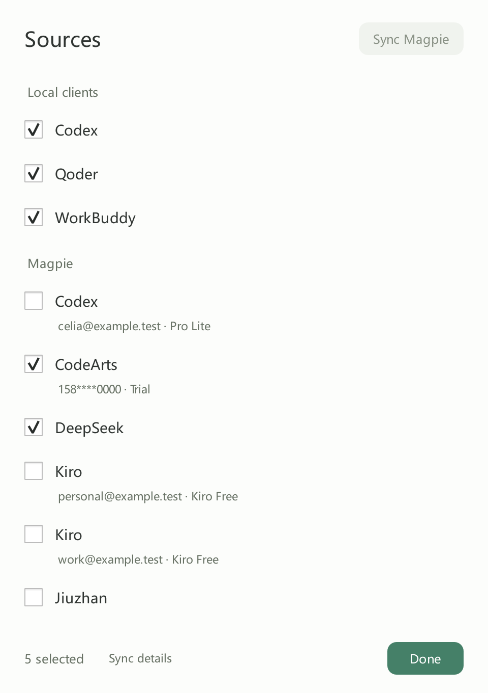
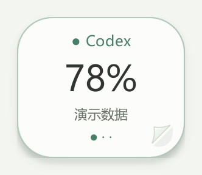

<div align="center">



# Quota Station

Keep your AI quotas in a quiet corner of your desktop.

**English** · [简体中文](README.zh-CN.md)

[](https://github.com/Seraph310/quota-station/releases/latest)
[](https://github.com/Seraph310/quota-station/actions/workflows/tests.yml)

[](LICENSE)

[Download](https://github.com/Seraph310/quota-station/releases/latest) · [Getting started](docs/DOWNLOAD.en.md) · [Report an issue](https://github.com/Seraph310/quota-station/issues/new/choose)

</div>



Quota Station is a small desktop widget for the AI accounts you choose to follow. See remaining quotas without opening every client, flip between accounts, or tuck the widget into a slim edge bar while you work or play.

## What it does

- **Your sources, your choice.** Pick individual accounts from local clients and Magpie. Choices apply immediately and are remembered.
- **Find and sync Magpie.** Detect its local installation and import the quota sources already connected there. No need to enter API keys again.
- **A card, an orb, or an edge bar.** Flip the card in either direction, double-click to expand, and drag the folded corner to resize. Dock at the left or right edge for a 12 px quota indicator; hover to peek.
- **Chinese and English.** Switch instantly from the `Language / 语言` menu, or follow your system language.
- **Updates inside the app.** Check for a release, download and verify it, then restart with your settings intact. Failed startup rolls back to the previous version.
- **Honest quota displays.** Unknown values stay unknown. Failed refreshes keep the last successful value and show its status. Different providers and currencies are never added together.

<div align="center">

</div>

All screenshots and animations use synthetic data rendered by the real app. No real accounts or credentials are shown.

## Download and start

Get the latest package from **[GitHub Releases](https://github.com/Seraph310/quota-station/releases/latest)**. Python is not required.

| System | Package | Start |
| --- | --- | --- |
| Windows 10/11 · x64 | `windows-x64.zip` | Extract the entire ZIP; open `QuotaStation/QuotaStation.exe` |
| macOS · Apple silicon | `macos-arm64.dmg` | Drag `Quota Station.app` into Applications |
| macOS · Intel | `macos-x64.dmg` | Drag `Quota Station.app` into Applications |

Sign in to the clients you use on this computer, then double-click the card and open **Sources**. For Magpie accounts, click **Sync Magpie**. Right-click the card or tray icon to find **Language / 语言** and **Check for updates**.

The Mac packages are built and tested on macOS 15. Windows packages are unsigned; Mac packages use ad-hoc signatures and are not notarized. See the [download guide](docs/DOWNLOAD.en.md) for first-launch instructions, update behavior, and settings locations.

## Supported sources

| Source | Windows | macOS | What you need |
| --- | :---: | :---: | --- |
| Codex | ✓ | ✓ | Codex CLI installed and signed in with a ChatGPT account |
| Qoder | ✓ | — | A signed-in Qoder App; legacy SDK/IDE fallback is also available |
| WorkBuddy | ✓ | — | WorkBuddy signed in as the same Windows user |
| Magpie accounts & API balances | ✓ | ✓ | A local Magpie installation with accounts already connected |

Magpie supplies the providers it has connected; Quota Station does not independently support every upstream provider. Native Qoder and WorkBuddy sign-in reading is currently Windows-only. Provider interfaces can change, and the upstream account page remains the source of truth. See [connection details](docs/SOURCES.en.md).

## Small gestures, fewer interruptions

| Gesture | Action |
| --- | --- |
| Click the card’s left / right half | Previous / next selected source |
| Click the orb | Next source |
| Double-click | Expand all selected quotas |
| Drag the body | Move the widget |
| Drag the folded corner | Resize the card, 80–200% |
| Drag past the left / right screen edge | Dock into a slim quota bar |
| Hover over the bar / move away | Peek / tuck back in without taking keyboard focus |
| Drag the bar inward | Restore the card |
| Esc / F5 | Collapse / refresh |



Quotas refresh every five minutes. Release checks happen silently once a day; installation starts only when you choose it. Hover for timestamps and details, or right-click an expanded quota row for its breakdown.

## Local data and privacy

Quota Station has no account relay server and no analytics. Native quota queries go to the respective providers; Magpie quotas come from its local gateway or CLI. Update checks and downloads contact this GitHub repository.

Your display preferences and cached balances stay on your computer. Local sign-in credentials are used to query the relevant provider and are never included in releases or public demo assets. WorkBuddy may read its local service process to recover a sign-in token when its encrypted cache is unavailable; any new token cache is protected with Windows DPAPI. The [connection guide](docs/SOURCES.en.md) explains these paths.

| Run mode | Settings and cache directory |
| --- | --- |
| Windows package | `%LOCALAPPDATA%\QuotaStation` |
| macOS package | `~/Library/Application Support/QuotaStation` |
| From source | `state/` and `.cache/` in the checkout |

Moving to another computer requires signing in to the relevant clients there. Do not publish your local `state/` or `.cache/` folders.

## Run from source

Python 3.11 or later:

```bash
git clone https://github.com/Seraph310/quota-station.git
cd quota-station
python -m venv .venv
```

Activate with `.venv\Scripts\Activate.ps1` on Windows PowerShell, or `source .venv/bin/activate` on macOS, then:

```bash
python -m pip install -r requirements.txt
python app.py
# Offline demo: synthetic data, no account access or quota requests
python demo.py --language en --expanded
```

Windows also has `install.ps1 -DesktopShortcut`. The optional legacy Qoder SDK needs Node.js 20+; current Qoder App connections do not. See [development and contribution notes](CONTRIBUTING.md).

## About and license

Created from a practical need: checking several AI quotas without interrupting work. Its behavior and visual design grew through everyday use, with Codex assisting implementation and testing. The [original Chinese case study](docs/case-study.md) records that process.

Quota Station is an independent project, not an official client of OpenAI, Qoder, WorkBuddy, or Magpie.

**Available for noncommercial use under the [PolyForm Noncommercial License 1.0.0](LICENSE).** Commercial uses outside its permitted purposes require separate authorization from the copyright holder. See [NOTICE](NOTICE). Third-party components retain their own licenses. This is source-available software with a noncommercial restriction, not an OSI open-source license.
