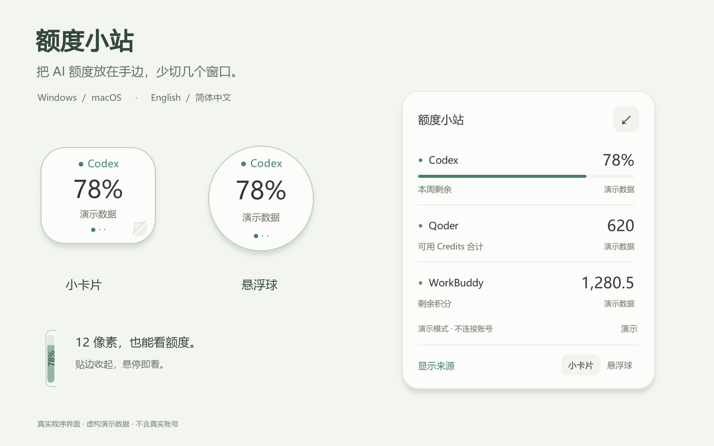
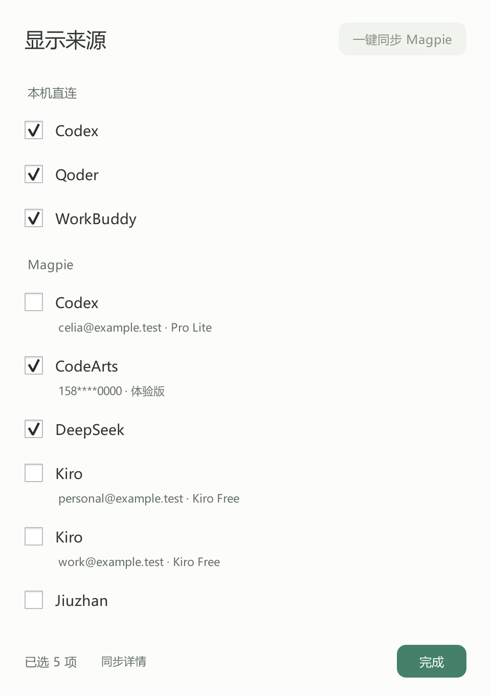
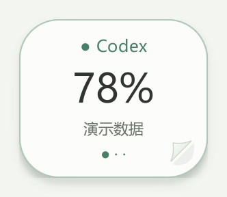

<div align="center">



# 额度小站 · Quota Station

把 AI 额度放在手边，少切几个窗口。

[English](README.md) · **简体中文**

[](https://github.com/Seraph310/quota-station/releases/latest)
[](https://github.com/Seraph310/quota-station/actions/workflows/tests.yml)

[](LICENSE)

[下载使用](https://github.com/Seraph310/quota-station/releases/latest) · [使用说明](docs/DOWNLOAD.md) · [反馈问题](https://github.com/Seraph310/quota-station/issues/new/choose)

</div>



额度小站是一款 Windows / macOS 桌面小组件，把你选中的 AI 账号额度集中放在手边。无需反复打开各个平台：点一下翻到下一个账号，双击查看全部，工作或游戏时还可以收成屏幕边缘的细条。

## 可以做什么

- **只看自己关心的来源。** 本机客户端与 Magpie 账号分别勾选，立即生效、自动记住；同一平台的多个账号也能独立选择。
- **一键同步 Magpie。** 自动检测本机安装位置，读取 Magpie 已接入的额度来源，无需再次填写 API Key。
- **小卡片、悬浮球、侧边条。** 支持双向卷角翻页、双击展开、拖动折角缩放。拖过屏幕左 / 右边缘，收成 12 像素额度条，悬停即可查看。
- **中英文即时切换。** 右键菜单选择 `Language / 语言`，可跟随系统，也可固定为简体中文或 English。
- **在小站里更新。** 检查新版本、下载校验、保留设置并重启；新版启动失败时自动回退。
- **如实展示额度。** 未知值显示“—”，刷新失败保留上次成功值并提示状态，不把不同平台或币种的额度相加。

<div align="center">

</div>

所有截图与动画均由真实程序渲染，使用虚构账号和演示数值，不包含真实账户或凭证。

## 下载与开始使用

从 **[GitHub Releases](https://github.com/Seraph310/quota-station/releases/latest)** 下载对应系统的程序，无需安装 Python。

| 系统 | 下载包 | 启动方式 |
| --- | --- | --- |
| Windows 10/11 · x64 | `windows-x64.zip` | 完整解压后打开 `QuotaStation/QuotaStation.exe` |
| macOS · Apple 芯片 | `macos-arm64.dmg` | 将 `Quota Station.app` 拖入 Applications |
| macOS · Intel | `macos-x64.dmg` | 将 `Quota Station.app` 拖入 Applications |

先在这台电脑登录你使用的客户端，再双击小卡片，打开 **显示来源** 勾选账号。使用 Magpie 时，点击 **一键同步 Magpie**。卡片和托盘的右键菜单都能找到 **Language / 语言** 与 **检查更新**。

Mac 包在 macOS 15 上构建和验证。Windows 包未做商业代码签名，Mac 包使用临时签名且未经 Apple 公证。首次启动、更新方法和设置位置见[下载版说明](docs/DOWNLOAD.md)。

## 支持的额度来源

| 来源 | Windows | macOS | 连接条件 |
| --- | :---: | :---: | --- |
| Codex | ✓ | ✓ | 安装 Codex CLI，并使用 ChatGPT 账号登录 |
| Qoder | ✓ | — | 登录 Qoder App；同时保留旧 SDK / IDE 回退路径 |
| WorkBuddy · Magpie | ✓ | ✓ | 已在 Magpie 连接账号，显示剩余总积分；WorkBuddy 客户端可以保持关闭 |
| WorkBuddy · 本机直连 | ✓ | — | WorkBuddy 桌面端已打开并登录，切换账号后自动跟随 |
| Antigravity · 本机直连 | ✓ | — | 官方桌面端已打开并登录，显示 Gemini 共用周额度（含 Argon）；关闭后保留上次读数 |
| Magpie 账号与 API 余额 | ✓ | ✓ | 本机安装 Magpie，已在其中连接账号 |

Magpie 来源取决于它已经接入的账号，不代表小站直接适配了所有上游平台。Qoder、WorkBuddy、Antigravity 的本机直连目前仅支持 Windows。客户端接口可能变化，额度以各平台自身页面为准。连接方式详见[完整中文指南](docs/GUIDE.zh-CN.md#额度来源与连接条件)。

## 小动作就够了

| 操作 | 效果 |
| --- | --- |
| 点击卡片左半边 / 右半边 | 上一页 / 下一页 |
| 点击悬浮球 | 下一个来源 |
| 双击 | 展开所有已选额度 |
| 拖动主体 | 调整桌面位置 |
| 拖动右下折角 | 缩放小卡片，范围 80%–200% |
| 拖过屏幕左 / 右边缘 | 吸附为额度细条 |
| 悬停细条 / 移开 | 展开查看 / 收回，不抢键盘焦点 |
| 把细条向屏幕内拖动 | 恢复小卡片 |
| Esc / F5 | 收起 / 刷新 |



额度每 5 分钟刷新一次。新版本每天静默检查，安装由你点击决定。悬停可看更新时间和明细，右键展开列表中的额度行可查看详细构成。

## 本地数据与隐私

小站不设账号中转服务器，也不收集使用分析。本机直连查询发送到对应平台；Magpie 额度通过本机网关或命令行读取。版本检查和下载会连接本 GitHub 仓库。

显示偏好和余额缓存保存在你自己的电脑上。本机直连的 WorkBuddy 通过当前账号标记和 Windows 辅助功能读取账号菜单中的积分余额；Antigravity 沿用官方客户端已有登录，通过其本机服务查询额度。详见[完整中文指南](docs/GUIDE.zh-CN.md#本地数据与兼容性)。

| 运行方式 | 设置与缓存位置 |
| --- | --- |
| Windows 下载版 | `%LOCALAPPDATA%\QuotaStation` |
| macOS 下载版 | `~/Library/Application Support/QuotaStation` |
| 源码运行 | 仓库中的 `state/`、`.cache/` |

换电脑后需要在新电脑登录相应客户端。请勿公开上传自己的 `state/` 或 `.cache/`。

## 从源码运行

需要 Python 3.11 或更高版本：

```bash
git clone https://github.com/Seraph310/quota-station.git
cd quota-station
python -m venv .venv
```

Windows PowerShell 执行 `.venv\Scripts\Activate.ps1`，macOS 执行 `source .venv/bin/activate`，随后：

```bash
python -m pip install -r requirements.txt
python app.py
# 离线体验：虚构数据，不读取账号，不查询真实额度
python demo.py --language zh-CN --expanded
```

Windows 也可使用 `install.ps1 -DesktopShortcut`。旧 Qoder SDK 可选路径需要 Node.js 20+，新版 Qoder App 连接不需要。开发和反馈方式见[贡献指南](CONTRIBUTING.md)。

## 关于与许可

这个项目从“能不能在桌面看一眼 AI 剩余额度”的实际需求开始。使用者提出需求、交互和视觉取舍，Codex 辅助实现与测试。最初的过程保留在[中文实践案例](docs/case-study.md)中。

小站是独立项目，不是 OpenAI、Qoder、WorkBuddy、Antigravity 或 Magpie 的官方客户端。

**采用 [PolyForm Noncommercial License 1.0.0](LICENSE)，仅授权许可条款允许的非商业用途。** 超出许可允许范围的商业用途，需要版权持有人另行授权。详见 [NOTICE](NOTICE)。第三方组件保留各自许可证。项目公开源码并限制商业使用，不将其宣传为 OSI 定义的开源软件。
