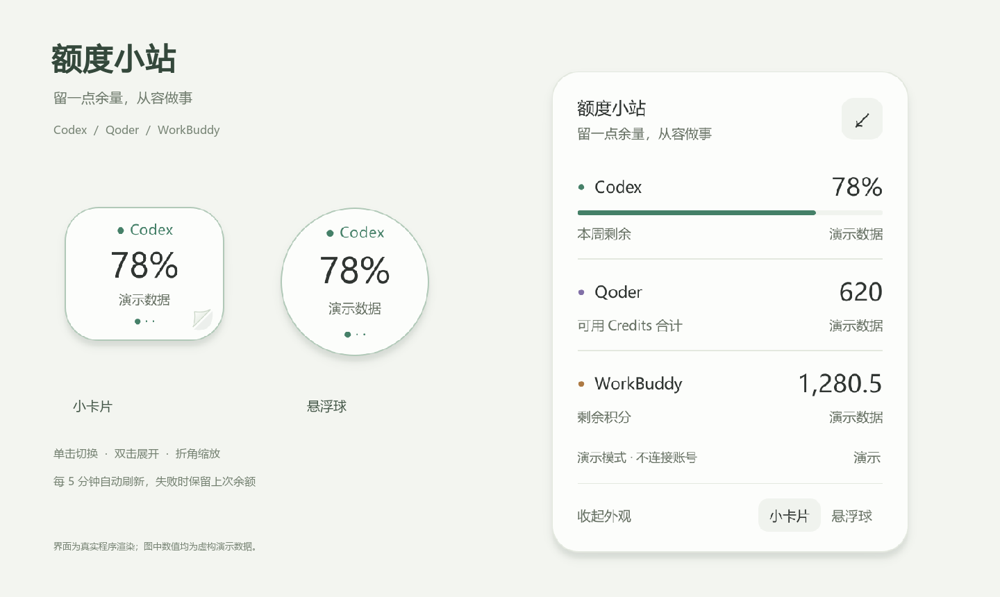
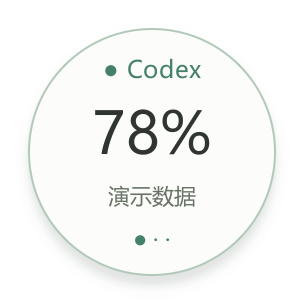
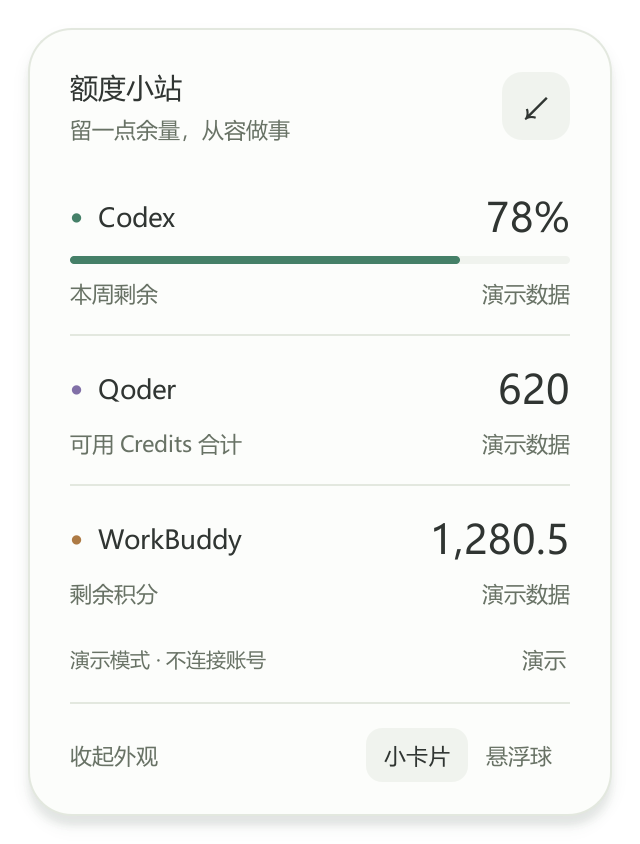

# 额度小站：把 AI 额度放在桌面一角

**课程：**《20款AIGC工具实战：从零打造你的AI工作矩阵》

**作业任务：**结合实际工作，运用任一或多款工具完成真实工作辅助案例。

**作者：**Seraph310

**案例类型：**Windows 桌面工作辅助工具

**主要创作工具：**Codex

**额度监测对象：**Codex、Qoder、WorkBuddy

> 本文配图均为成品界面的演示数据展示，不代表作者的真实账户额度。

## 1. 从真实工作需要出发

在生物信息学工作中，我会借助不同 AI 工具处理代码、资料整理与文档等任务。切换工具时，需要知道当前账号还有多少可用额度，以及部分额度的恢复时间，才能安排接下来的工作。额度分散在不同客户端中，逐个打开查看会打断当前操作。

已有的 WorkBuddy 积分球可以显示单一工具的余额，但外观较简陋，也无法同时覆盖其他工具。因此，我希望做一个放在桌面一角的小组件：平时尽量小，查看时一眼能懂，需要细节时再展开。

目标是把真实账号的额度信息汇集到一个入口，同时让它像一张安静的桌面便签，能够融入日常工作环境。

## 2. 用具体反馈推进迭代

我向 Codex 提出工作需求，并在看到成品后继续反馈外观与操作感受。Codex 负责界面实现、数据读取适配、问题排查与测试；我负责判断它是否符合自己的使用习惯，以及决定下一步修改。

本案例的主要创作工具是 Codex；Qoder 和 WorkBuddy 是额度监测对象。这样的分工对应各工具在作品中的实际作用。

| 用户需求与反馈 | 落地修改 |
| --- | --- |
| 希望外观更精致，并与桌面便签融合 | 采用奶白、淡绿、淡紫配色，提供小卡片、悬浮球和展开便签三种形态 |
| 平时只占桌面一小块空间 | 单击按 Codex → Qoder → WorkBuddy 轮换，双击展开明细便签 |
| 调整大小时操作要自然 | 拖住小卡片右下角折角等比例缩放，文字同步缩放，松手后记住大小 |
| 收起后不要丢失当前选择 | 收起继续显示刚才选择的工具，保存位置、大小、外形和置顶设置 |
| 从 Qoder IDE 换成新版独立 Qoder App | 新增 App 读取路径，优先跟随新版 App 的账号，不要求打开旧 IDE |

## 3. 实现方法与可靠性处理

界面使用 Python 和 PySide6。PySide6 是用于构建桌面窗口的 Python 工具库，适合实现无边框小窗口、系统托盘、拖动与缩放等交互。

数据读取分为三个独立适配器，再统一交给界面显示。Codex 读取其账户额度接口；Qoder 兼容新版独立 App，并为旧环境保留 SDK 与 IDE 的读取方式；WorkBuddy 在原有积分球的余额读取思路上继续适配。这里的“只读”是查询账户用量，不通过提交模型任务来探测余额。

几个实现细节直接影响是否能放心使用：

- **不把失败当成零。**读取失败时保留上次成功余额，并显示更新状态与时间；缺失或异常字段不伪装成零额度。
- **不同计量分别展示。**Codex 以额度窗口与恢复时间为主，Qoder 和 WorkBuddy 按积分显示，不把三家额度混成一个总数。
- **账号来源不混用。**本机已有新版 Qoder App 账号时，查询失败不会自动切换到另一个 IDE 或 CLI 账号。
- **登录信息不公开。**不保存明文凭证，不把账户数据上传到额外的第三方服务；公开仓库与案例配图不包含登录文件和真实余额。
- **支持日常使用。**默认每 5 分钟刷新，可手动刷新；重复启动会唤回已有小组件。

## 4. 已完成的结果与验证

额度小站已经在真实 Windows 桌面投入使用。最近一轮本机实测中，Codex、Qoder、WorkBuddy 三家均成功返回额度；新版 Qoder App 0.4.3 的读取路径也已验证。

本轮基础验证包含 **92 项通过的自动化测试**，覆盖数据解析、异常与回退处理、账号来源隔离、刷新与交互、演示状态隔离等行为。同时检查了小卡片、悬浮球和展开便签的实际界面效果。公开图由真实成品界面生成，显示演示数值。

这个案例的实际价值是把分散的额度查看入口集中到桌面，并把用户的外观和操作反馈落实为可持续使用的小工具。尚未开展定量效率评估，因此这里只报告功能、验证结果与实际使用体验。

## 5. 当前边界与后续改进

客户端内部兼容接口可能随版本变化而需要维护；本工具目前依赖 Windows 环境，尚未进行大规模跨机器测试。单台机器上的成功不能等同于所有账号、网络与客户端版本都已兼容。

适合继续改进的方向是：完善安装说明与异常提示，在更多 Windows 环境验证，以及持续维护客户端升级后的读取兼容性。

## 6. 交付内容与复现入口

- 程序源码、测试与使用说明：GitHub 项目。
- 本文：可阅读、可修改的 Markdown 案例说明。
- PDF：约四页的图文实践案例，可作为培训作业展示材料。

项目地址：[Seraph310/quota-station](https://github.com/Seraph310/quota-station)。

## 官方接口参考

- [Codex App Server](https://learn.chatgpt.com/docs/app-server)
- [Qoder Agent SDK：Cost and usage](https://docs.qoder.com/cli/sdk/cost-usage)
- [Qoder 独立桌面产品说明](https://docs.qoder.com/qoder/overview)

Qoder App 与 IDE 的部分本地读取路径属于客户端兼容实现，不能等同于公开稳定 API；实际支持条件以仓库说明为准。
